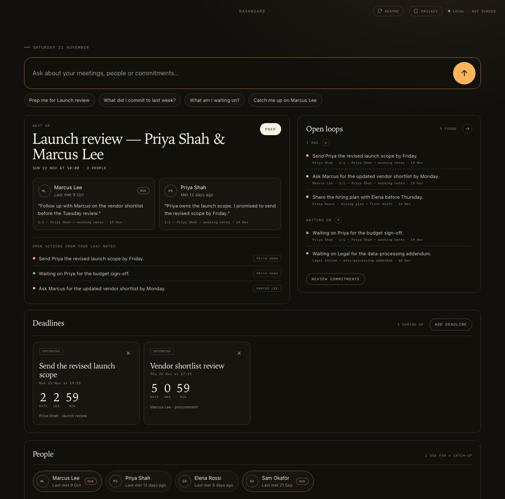
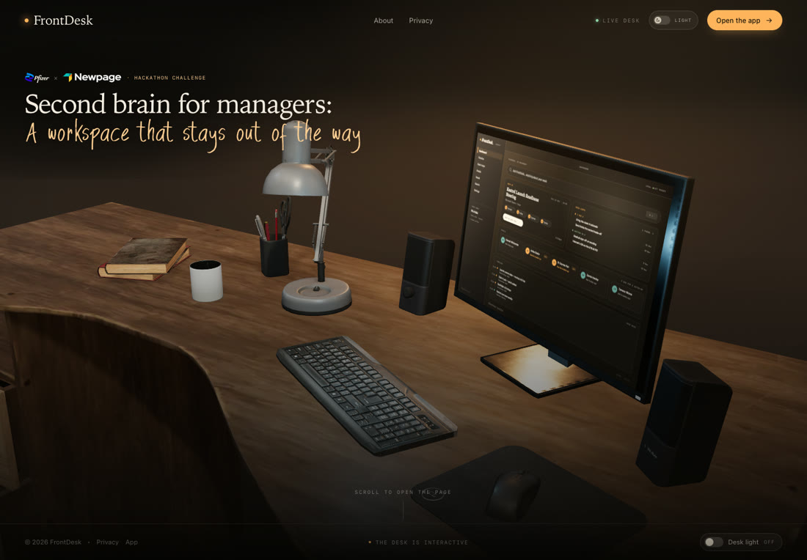

# FrontDesk

**A local-first second brain for managers** — built for the Pfizer & Newpage Solutions Hackathon Challenge.

FrontDesk is a Tauri desktop app with a Rust core. It reads only the sources you grant, keeps originals where they live, and turns notes, mail, calendar events, OneNote and meetings into a manager-shaped day.

**Stack**


## Screenshots

| Dashboard | Web front page |
| :---: | :---: |
|  |  |

## Features

- **Dashboard** — next meeting, open commitments, people catch-up nudges, deadline countdowns and recent activity.
- **Ask** — chat with inline `[n]` citations, source previews and a **Strict citations** mode that refuses outside knowledge.
- **Open loops** — swipe a commitment to mark it **Done** or **Delete** it; hidden items can be restored.
- **Deadlines** — add a date from the dashboard or straight from a chat answer; day/hour/minute counters update live.
- **Timeline & Search** — search notes, mail, scans and meetings; every result opens the original.
- **People graph** — departments, roles and relationship strength from Microsoft 365, mail signatures and notes.
- **Saved** — save answers as Markdown in a folder you own, with category filters and Finder reveal.
- **Meetings** — record the microphone, transcribe locally with Whisper and write notes with the local model. Audio is deleted after transcription.
- **Privacy shield** — blurs the whole window when a remote-access tool is detected, or with `⌘⇧P`.
- **Sources** — local folders, PDFs, handwritten scans via Apple Vision, Outlook, Calendar and OneNote.
- **Menu bar & local model** — next three calendar items from the tray; Phi-4 Mini runs locally, or use Extractive mode with no model.

Ask retrieves before it generates: hybrid BM25 + local vector candidates are reranked, the model writes with numbered excerpts, and a second local pass verifies each sentence against the evidence. Unsupported sentences stay uncited; strict and personal answers drop them and abstain rather than guess.

## Run

Requirements: Node 20+, npm 10+, Rust stable, and Xcode Command Line Tools on macOS (or the Tauri Linux packages).

```bash
npm ci
npm run doctor
npm run dev:tauri        # desktop app
npm run dev              # landing page at localhost:5173
npm run package:desktop  # macOS/Windows/Linux installers
```

Useful docs: [Microsoft demo setup](MICROSOFT_DEMO_SETUP.md) · [landing page](web/) · [desktop app](desktop/)

## Privacy

- No FrontDesk server. Source text is read on demand and never copied into app data.
- Microsoft Graph access is read-only and limited to the five scopes in the demo setup.
- Embeddings and metadata are local; the audit log records what was read, never what it said.
- Meeting audio is temporary and deleted after a successful transcription.
- Grants are revocable at any time; the About notebook can hide its photos when a screenshot is likely.

## Acknowledgements

- Meeting capture and local transcription were informed by [Meetily](https://github.com/Zackriya-Solutions/meetily) (MIT). Meetily in turn credits [Whisper.cpp](https://github.com/ggerganov/whisper.cpp), [Screenpipe](https://github.com/mediar-ai/screenpipe) and [transcribe-rs](https://crates.io/crates/transcribe-rs).
- The architecture graph was made with [Archify](https://github.com/tt-a1i/archify).
- Local inference uses [llama.cpp](https://github.com/ggerganov/llama.cpp) and [Whisper.cpp](https://github.com/ggerganov/whisper.cpp).

## Team

- [Anika Srivastava](https://www.linkedin.com/in/anika-srivastava-00b032229/)
- [Zeynep Yılmaz](https://www.linkedin.com/in/yilmazzey/)
